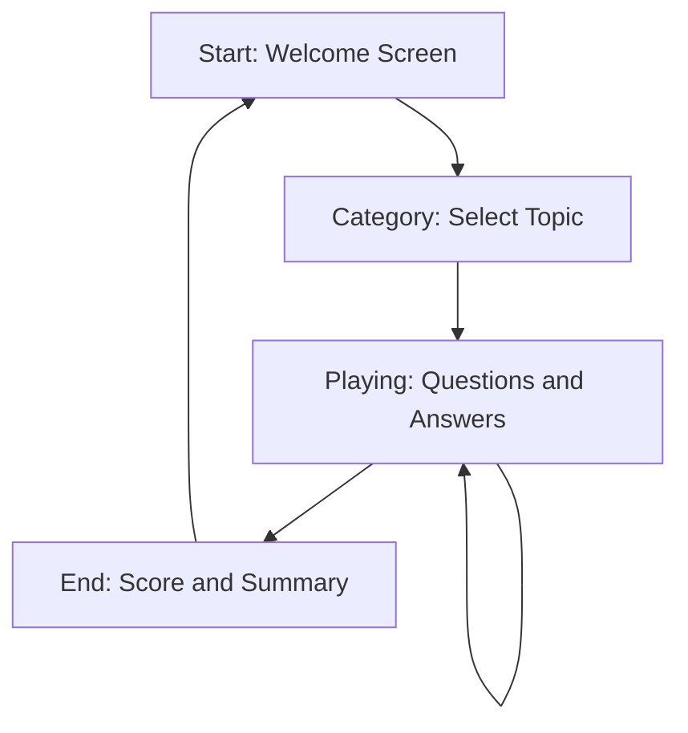

# Quiz React (`@vitoria-rodrigues/quiz-react`)

A React-based interactive quiz application built with Vite 7 and React Context API for managing programming trivia across multiple categories.

---

## 1. Technology Stack

- **Runtime and Framework**: React 19
- **Build Tool**: Vite 7
- **Language**: JavaScript (ES Modules)
- **Code Quality**: ESLint 9
- **Styling**: Vanilla CSS
- **Package Management**: pnpm 10 with `catalogMode: strict`

---

## 2. Architecture Overview

The application implements a unidirectional state architecture using React Context API (`QuizContext`) and a centralized reducer (`quizReducer`). The user progresses through four distinct game stages: `Start`, `Category`, `Playing`, and `End`.



> [!NOTE]
> Questions within a selected category are automatically shuffled upon game initialization to provide a unique session order.

### Project Structure

```text
quiz-react/
├── .agents/
│   └── plugins.json            # Antigravity plugin registry (@vitoria-rodrigues/agent-mesh)
├── src/
│   ├── components/             # Modular UI views (Welcome, PickCategory, Question, Option, GameOver)
│   ├── context/
│   │   └── quiz.jsx            # Central state provider and reducer
│   ├── data/                   # Categorized question banks (HTML, CSS, JavaScript)
│   ├── img/                    # SVG illustrations for game stages
│   ├── App.css
│   ├── App.jsx
│   ├── index.css
│   └── main.jsx
├── AGENTS.md                   # Sovereign root context router (Layer 1)
├── eslint.config.js            # ESLint flat configuration
├── index.html                  # HTML entry document
├── package.json                # Scoped manifest (@vitoria-rodrigues/quiz-react)
├── pnpm-lock.yaml              # Deterministic pnpm lockfile
├── pnpm-workspace.yaml         # Centralized pnpm dependency catalogs
├── README.md                   # Primary developer documentation
└── vite.config.js              # Vite bundler configuration
```

---

## 3. Getting Started

### Prerequisites

- Node.js 20 or higher
- pnpm 10 or higher

### Installation & Local Development

1. Clone the repository and navigate to the project directory:

```bash
git clone https://github.com/Vitoria-Rodrigues/quiz-react.git
cd quiz-react
```

2. Install dependencies:

```bash
pnpm install
```

3. Start the local development server:

```bash
pnpm dev
```

4. Open the local address displayed in the terminal (typically `http://localhost:5173`) in your browser.

---

## 4. Key Scripts

| Command | Description |
| :--- | :--- |
| `pnpm dev` | Starts the Vite development server with Hot Module Replacement (HMR). |
| `pnpm build` | Bundles the application for production deployment into the `dist/` directory. |
| `pnpm preview` | Locally previews the production build. |
| `pnpm lint` | Executes ESLint to verify code quality and syntax standards. |

---

## 5. AI Agent Mesh Integration

This repository consumes organizational AI agent skills, rules, and MCP configurations via `@vitoria-rodrigues/agent-mesh` declared in `catalog:plugins-stack` ([pnpm-workspace.yaml](./pnpm-workspace.yaml)) and mounted through [.agents/plugins.json](./.agents/plugins.json).

---

## 6. Governance Standards

1. **Conventional Commits**: All commits must follow `<type>(<scope>): <description>` (v1.0.0).
2. **Cryptographic Signing**: Sign commits with SSH (`git commit -S -m "..."`) when a signing key is configured.
3. **Zero-Emoji Invariant**: Emojis are strictly prohibited in code, documentation, and commit messages.
4. **Language Policy**: Technical documentation, code, and commit messages are written strictly in en-US.
