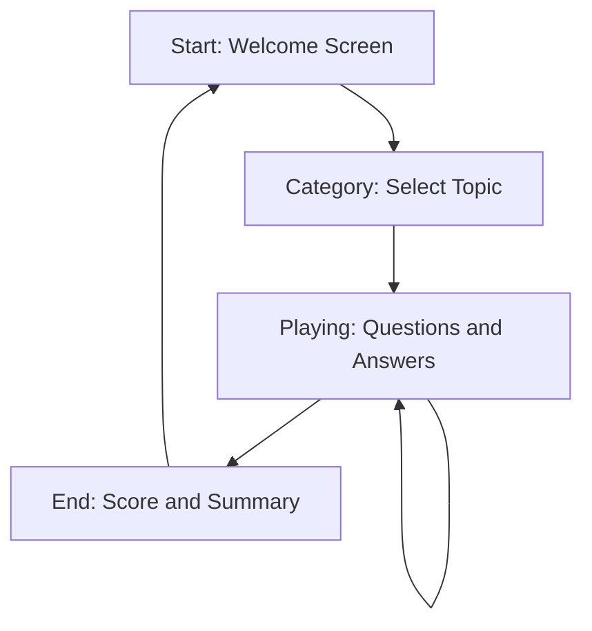

# quiz-react

A React-based interactive quiz application built with Vite and React Context API for managing programming trivia across multiple categories.

## Technology Stack

- Runtime and Framework: React 19
- Build Tool: Vite 7
- Language: JavaScript (ES Modules)
- Code Quality: ESLint 9
- Styling: Vanilla CSS

## Getting Started

### Prerequisites

- Node.js (version 18 or higher recommended)
- npm or a compatible package manager

### Installation

1. Clone or navigate to the repository directory.
1. Install project dependencies:

```bash
npm install
```

1. Start the local development server:

```bash
npm run dev
```

1. Open the local address provided in the terminal (typically `http://localhost:5173`) in your browser.

## Key Scripts

- `npm run dev`: Starts the Vite development server with Hot Module Replacement.
- `npm run build`: Bundles the application for production deployment into the `dist` directory.
- `npm run preview`: Locally previews the production build.
- `npm run lint`: Executes ESLint to check code quality and syntax standards.

## Architecture

The application implements a unidirectional state architecture using React Context API (`QuizContext`) and a centralized reducer (`quizReducer`).
The user progresses through four distinct game stages: `Start`, `Category`, `Playing`, and `End`.

### State Machine Workflow



### Directory Structure

- `./src/components/`: Modular UI view components (`Welcome`, `PickCategory`, `Question`, `Option`, `GameOver`).
- `./src/context/`: Central state provider and reducer logic managing questions, score, and game phase.
- `./src/data/`: Static question banks categorized by topic (HTML, CSS, JavaScript).
- `./src/img/`: SVG vector assets for game stages and category headers.

> [!NOTE]
> Questions within a selected category are automatically shuffled upon game initialization to provide a unique session order.
